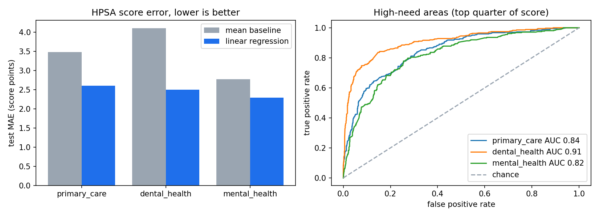

# BigQuery ML: Health Professional Shortage Area analytics

[](https://doi.org/10.5281/zenodo.23272224) (v1.0.0 archive; see "Version 2" below)

SQL-first machine learning on the US Health Resources and Services Administration (HRSA) shortage area tables in
BigQuery's public data, with BigQuery ML models and a Kaggle notebook that repeats the analysis in Python.

## Question
How much of a Health Professional Shortage Area's (HPSA) priority score can be predicted from where it is and what
kind of designation it is (HHS region, state, rural status, designation type, population type, metropolitan
indicator), **without** the numbers HRSA uses to compute the score?

## Version 2: leakage fix
Version 1.0.0 trained a logistic model to predict "Shortage" from `HPSA_Score`, and a linear model to predict
`HPSA_Shortage` from `HPSA_Score`. Both values come out of the same HRSA designation calculation (population to
provider ratio and related need measures), so the models were learning a definition, not a pattern. Version 2:

- uses only context features (`Primary_HHS_Region_Name`, `Common_State_Abbr`, `Rural_Status_Desc`, `Type_Desc`,
  `HPSA_Pop_Type_Desc`, `Metropolitan_Indicator_Desc`) and leaves out `HPSA_Shortage`, `Degree_of_Shortage`,
  `Total_FTE_Clinicians`, `Formal_Ratio`, `Percent_Pop_Below_Poverty` and the population counts;
- builds one row per area (rows grouped by `HPSA_Name`) before splitting, so one area cannot sit in train and test;
- splits 80/20 with a hash of the area name (`FARM_FINGERPRINT`), the same rule in BigQuery and on Kaggle;
- compares every model with a baseline (training mean for the score, majority class for high need);
- keeps the old scripts in [`queries/archive_v1/`](queries/archive_v1/) for the record. The old screenshots showed
  the leaky models, so they were removed; they remain in the git history and the v1.0.0 archive.

## Data
`bigquery-public-data.sdoh_hrsa_shortage_areas`: tables `hpsa_primary_care`, `hpsa_dental_health` and
`hpsa_mental_health` (HRSA data published in BigQuery's public datasets). Withdrawn areas and areas proposed for withdrawal are left out.
`queries/00_check_columns.sql` lists the real columns; the notebook stops with a clear message if any column the
SQL needs is missing.

| Target | Model | Baseline | Metrics |
|---|---|---|---|
| `hpsa_score` (HRSA priority score) | linear regression | training mean | MAE, RMSE, R² |
| `high_need` (score in the top quarter of the training split) | logistic regression | majority class | ROC AUC, accuracy, F1 |

## Repository
```text
queries/
  00_check_columns.sql            real column names of the three tables
  01_features.sql                 one row per area, context features, split, high_need (source of truth)
  02_bqml_linear_score.sql        BigQuery ML linear regression + mean baseline
  03_bqml_logistic_high_need.sql  BigQuery ML logistic regression + majority baseline
  archive_v1/                     original v1 scripts (leaky, kept for the record)
notebooks/kaggle_bigquery_hpsa.ipynb   same SQL from Python on Kaggle, all three tables, bootstrap CIs, chart
tests/test_repo.py                offline checks (no leaky columns, one split rule, model code on fake data)
```

## How to run
**BigQuery console** (your own Google Cloud project; the free sandbox is enough for this size): run the files in
`queries/` in order 00 to 03. `01` creates the dataset `medical_ml` (location US) and the table `hpsa_features`.

**Kaggle**: File > Import Notebook > GitHub, paste
`https://github.com/MHKhan50/enterprise-bigquery-ml-healthcare/blob/main/notebooks/kaggle_bigquery_hpsa.ipynb`,
turn Internet on and Run All. It reads the SQL from this repo, so the SQL files stay the single source.
The notebook uses scikit-learn for the same two model types, because creating BigQuery ML models needs your own
project.

**Tests** (offline): `pip install -r requirements.txt && python -m pytest -q tests`

## Results
Kaggle run on 5 Nov 2026 (scikit-learn, same SQL and split). Test set = areas the models never saw.
Raw numbers: [`results/results.json`](results/results.json).

**HPSA score (linear regression vs training mean)**

| Table | Train / test areas | Mean baseline MAE | Linear MAE | MAE gain (95% CI) | R² |
|---|---|---|---|---|---|
| Primary care | 5,747 / 1,369 | 3.48 | 2.60 | 0.88 (0.75 to 1.00) | 0.40 |
| Dental health | 5,165 / 1,203 | 4.10 | 2.50 | 1.60 (1.42 to 1.80) | 0.58 |
| Mental health | 4,710 / 1,138 | 2.77 | 2.29 | 0.49 (0.39 to 0.59) | 0.28 |

**High-need areas, top quarter of score (logistic regression vs majority class)**

| Table | High-need share (test) | Majority accuracy | Logistic accuracy | F1 | ROC AUC (95% CI) |
|---|---|---|---|---|---|
| Primary care | 26.7% | 73.3% | 82.0% | 0.63 | 0.84 (0.82 to 0.87) |
| Dental health | 28.9% | 71.1% | 87.1% | 0.77 | 0.91 (0.89 to 0.93) |
| Mental health | 27.3% | 72.7% | 78.7% | 0.56 | 0.82 (0.79 to 0.84) |



What this shows: context features alone beat both baselines on all three tables, with confidence intervals that
stay clear of zero gain and of AUC 0.5. The signal is strongest for dental and weakest for mental health. Without
leakage the models explain a part of the score (R² 0.28 to 0.58), not all of it, which is what an honest model
of a formula-based score should look like when the formula inputs are left out.

The BigQuery ML scripts in `queries/02` and `queries/03` fit the same model types in the console; their numbers
can differ slightly (different solver and regularisation) and are not reported here.

## Limitations
- Areas are grouped by name; two different areas with the same name would be merged.
- The context features are coarse, so a modest result is expected; the point is an honest number with no leakage.
- Designation type (`Type_Desc`) includes categories such as high-needs geographic designations, which are defined
  partly by need, so it may carry part of the score's own logic. A run without this feature is the next check.
- One snapshot of a public table; the data changes as HRSA updates designations.
- Association only; nothing here says why an area is short of clinicians.

## Author
Muzammal Hussain, Software Engineer, Data Scientist and AI Researcher. GitHub: [MHKhan50](https://github.com/MHKhan50),
ORCID: [0009-0001-2570-5686](https://orcid.org/0009-0001-2570-5686)

## Citation
See [`CITATION.cff`](CITATION.cff). Version 1.0.0: https://doi.org/10.5281/zenodo.23272224
